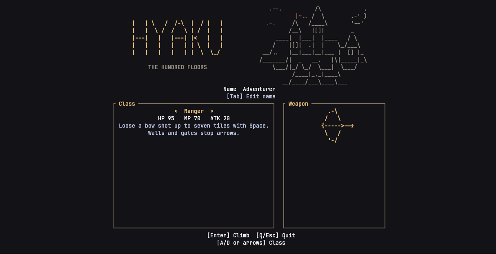
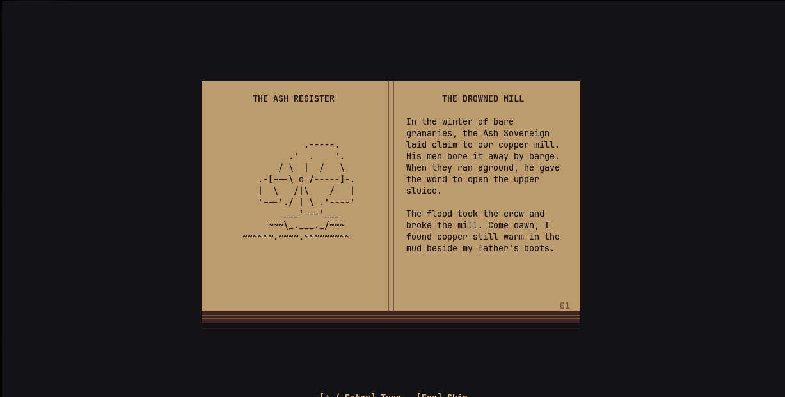
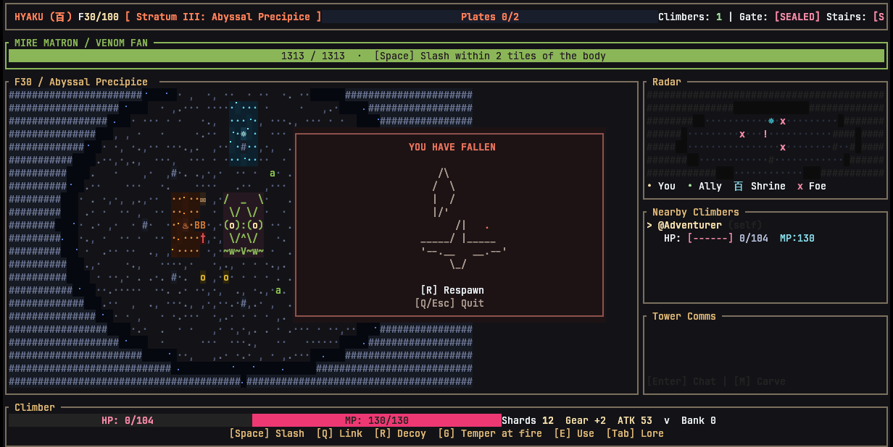

# Hyaku (百)

Hyaku is a real-time co-op dungeon crawler for the terminal. You start by a campfire at the foot of a 100-floor tower.

## Play

The Linux and macOS installer puts `hyaku`, its local server companion, and `hyaku-update` on your system.

~~~sh
curl -fsSL https://raw.githubusercontent.com/DeadZone-0/hyaku/main/install.sh | bash
hyaku
~~~

The client defaults to the Hack Club Nest server at `ws://[2a01:4f9:3080:3192::2124]:3000/ws`. Use `hyaku-update` when a new release comes out. Pass `--server URL` to pick a server, `--connect` to skip the title screen, or `--mute` to turn off audio. The rest of this guide describes the code in this checkout.

## Screenshots

## Play locally

Build both binaries and let the client start a temporary server.

~~~sh
cargo build --workspace
cargo run -p hyaku-client -- --local-server
~~~

The server shuts down when you quit, and its save is temporary. For a world you can come back to, run `cargo run -p hyaku-server` in one terminal and `cargo run -p hyaku-client -- --local` in another.

### Solo Gatekeeper practice

~~~sh
./run_raid.sh 20
./run_raid.sh 100
~~~

Select raid / boss level between 10-100. If raid is unspecified, ./run_raid.sh will prompt. Upon starting the raid you will be on a local server with equipment for the selected floor. You should have enough shards to upgrade once more. Press G when at the spawning fire to use shards. Approach the Boss and press space. Melee range is 2 tiles, while Ranged (arrows) is 7.

Boss has 1/3 HP. Place decoy (R), circle around boss and press Q within 13 tiles of the decoy. Ensure that the tether crosses through the Boss. In co-op, ensure you are linked to an alive ally. Once the shield breaks there is a small window to attack. To unlock the gate, place a decoy on one plate and stand on the other.

## Controls

| Key | Action |
| --- | --- |
| WASD or arrows | Move and turn. |
| Space | Attack in the direction you face. Ranger arrows stop at the first enemy, wall, or closed gate. |
| Q | Link or sever a lightning tether. Reach is eight steps, or 13 on raid floors. |
| R | Place a holo-decoy for 20 mana. After death, respawn at your campfire or the floor entrance. |
| B | Spend 5 shards to bridge the chasm tile in front of you. |
| E | Use a shrine, revive a fallen ally, or climb. Stand on the stairs to ascend. |
| Z | Offer carried shards while near a shrine. |
| C | Spend 15 shards to build a permanent campfire on bare stone. |
| G | Spend shards at a campfire to forge an Ember and temper your gear. The first rank costs 8 shards. Each rank gives 9 attack, 12 max HP, and 5 max MP. |
| M | Carve a message on bare stone. Enter saves the message and Esc cancels. |
| L | Praise a nearby carving once. Its author heals if they're alive. |
| Tab | Open or close the Hall of Fame. Browse with arrows or Page Up and Page Down. |
| Enter | Open or send floor chat. After victory, choose to stay at the summit. |
| 1–4 | Send quick co-op callouts. |
| Esc | Close the current prompt or quit while exploring. |

On the title screen, A/D or the arrow keys switch classes, Tab edits your name, and Enter joins. For `--class`, use 0 for Blade, 1 for Arcanist, 2 for Ranger, or 3 for Architect.

New climbers start with *The Ash Register*. Press Right or Enter to turn a page, Left to go back, and Esc to skip. On the last page, Enter closes the book and drops it before Floor 1 starts. The story of the drowned mill draws on the breaking of the Sampo. [Kalevala, Runo XLIII, translated by W. F. Kirby](https://www.gutenberg.org/cache/epub/33089/pg33089-images.html).

## Climbing and saving

Linked plates can be used to unlock gates. Shards can be offered to the shrine to unlock the staircase. On every 10th floor, a specific boss appears. Danger tiles will disappear after 20 server ticks. On these floors, the staircase will be unlocked by opening both plates, and also by defeating the boss. The ending is triggered by taking the staircase on Floor 100, after defeating Ash Sovereign.

Bridges, campfires and carvings remain. Campfires heal players in a radius of 2 tiles for 1 health per server tick. The Hall of Fame shows who was first to reach each floor.

Continue from where you left off by connecting with the same character profile, name. Every 5 seconds and on disconnect, your progress will be saved on the server. If another character profile has the same name as you, then they will have their own saved progress.

## How it works

~~~mermaid
flowchart LR
    A["Ash's terminal"] <-->|WebSocket| S["Authoritative server"]
    B["Ember's terminal"] <-->|WebSocket| S
    S <-->|Atomic JSON saves| D[("hyaku_save.json")]
    P["Shared protocol and map generator"] -.-> A
    P -.-> B
    P -.-> S
~~~

The client in `crates/hyaku-client` handles input, draws the terminal, plays audio, and predicts movement. The server in `crates/hyaku-server` checks actions and sends floor snapshots roughly 30 times a second. Both use `crates/hyaku-protocol` for packets, tile rules, and map generation.

~~~mermaid
sequenceDiagram
    participant C as Client
    participant S as Server
    participant F as Floor
    C->>S: Move, attack, tether, or interact
    S->>F: Check and apply the action
    F-->>S: Advance combat, plates, and timers
    S-->>C: Send the next snapshot
    Note over C: Draw bursts from changes between snapshots
~~~

The dedicated server keeps `hyaku_save.json` in its working directory. It stores floor progress, Hall of Fame entries, structures, carvings and their votes, and keyed resume locations. Set `HYAKU_SAVE_PATH` to change the save location or `HYAKU_BIND_ADDR` to change where the server listens.

Resume works on loopback and on encrypted `wss://` connections. The current public Nest address uses plain `ws://`, so updated clients join there as guests. Resume keys are scoped to the server URL, so switching to a new address starts a new resume profile.

For public hosting, terminate TLS at a reverse proxy and point clients at `wss://YOUR_HOST/ws`. Set `HYAKU_TRUSTED_PROXY` to the proxy's IP as seen by Hyaku, and restrict backend access to that proxy. If both run on the same machine, use `HYAKU_BIND_ADDR=127.0.0.1:3000` and `HYAKU_TRUSTED_PROXY=127.0.0.1`. The proxy must set `X-Forwarded-Proto: https` and put the real client IP last in `X-Forwarded-For`. Hyaku only reads those headers from the configured proxy.

Run `cargo test --workspace` to check the shared rules, client rendering, combat, and save restoration.

## Audio credits

The music and effects below are CC0.

- Dungeon loop. [Whispers in the Fog by Ruhinre](https://opengameart.org/content/whispers-in-the-fog).
- Raid loop. [Determined Pursuit by Emma_MA](https://opengameart.org/node/70268).
- Sword effects. [StarNinjas](https://opengameart.org/node/122900).
- Menu clicks, chimes, gongs, and hurt sound. [rubberduck](https://opengameart.org/content/100-cc0-sfx).
- Page turn, trimmed from a recording. [Page Turning by XanTheRock](https://freesound.org/people/XanTheRock/sounds/537872/).

The raid track fades in when the fight starts and fades back to the dungeon loop when it ends. On macOS, the game plays ambience through Core Audio and effects through `afplay`. On Linux, it tries `pw-play`, `paplay`, `ffplay`, and `aplay`.

## smth i have to say 

So its been a very very fun project as i dont have much experience with multiplayer faced many issue ...too many actually yea....the best part i liked about it obv the page turn sound and the bgm of the game so peakk  Hope u guys enjoy it cyaa 

## Ai usage 

Not much i have basically used it in audio handling for MacOS as i dont have a mac and i dont know how it works also refined the map generation in the end , installer is made by ai , and the flowchart in readme ( they r weird indeed ), just remembered i have also used it to fix latency issue ... (i have modified them after anyways)
